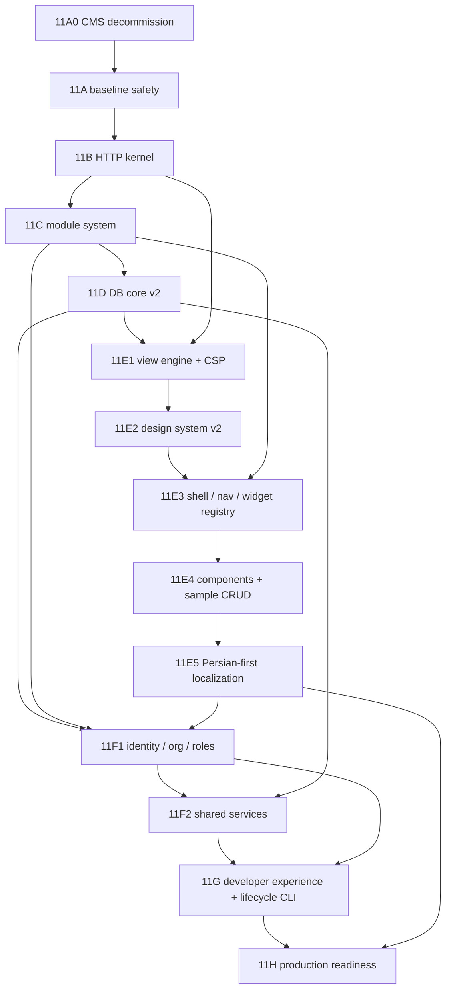

# Part 11 roadmap — from website builder to a modular admin application platform

**Revision 2.** Replaces the earlier roadmap completely. Language: English (reports to the owner are Persian).

## 0. Where we are (honest status)

Status vocabulary (one word per part, nothing else is allowed): `Authored` → `Reviewed` → `Ready` → `Executed` → `Verified` → `Released`.

- `Authored`: the prompt text exists. `Reviewed`: someone other than the author read it. `Ready`: the author replayed it literally on a clean copy of the previous tree and it passed its own gates. `Executed`: the OpenCode agent applied it and wrote `executed` through `tools/ai/mark_part.php`. `Verified`: the owner checked the manual list. `Released`: it ran on the real stack (Apache + MySQL/MariaDB + PHP 8.0) and the release checklist of 11H is signed.
- The executor may write only `executed`, `partial`, `blocked`. `Verified` and `Released` are written by the owner.

| Prompt | File | Status now | What "Ready" means here |
|---|---|---|---|
| 11A0 | `master-prompt-11A0-product-reset-cms-decommission.md` | **Ready** | replayed on a copy of the real repo snapshot: 13 tests, manifest 155 ok, `cms leftovers: 0`; MySQL migration path **not** run (SQLite only) |
| 11A | `master-prompt-11A-baseline-safety.md` | **Ready** | replayed after 11A0: 17 tests, manifest 15 ok, gate 0 violations |
| 11B | `master-prompt-11B-http-kernel.md` | **Ready** | replayed after 11A: 24 tests, manifest 39 ok, gate 0 violations; real Apache `.htaccess` **not** run |
| 11C | `master-prompt-11C-module-system.md` | **Ready** | replayed after 11B: 28 tests (166 module checks), manifest 29 ok, gate 0 violations |
| 11D … 11H | — | **not written** | each is written one at a time, after the previous part was applied and its real outputs are known (section 5) |

No part has been `Reviewed` by a second person; none has been `Executed` by the owner yet. All four ready prompts were tested on PHP 8.3 + SQLite only.

## 1. Product definition

The product is a **generic admin application platform** (a starter kit): a Persian-first, RTL, secure admin shell on which business modules are added as folders. It is no longer a website builder or CMS. The CMS is removed (11A0), not hidden.

Three layers (every future file belongs to exactly one):

| Layer | Meaning | Rule |
|---|---|---|
| **Core platform** | Needed by every installation; cannot be disabled. | Changes need an ADR line. No business words. |
| **Platform service** | Reusable capability offered to modules through a contract (interface/registry). | One owner part per service. Replaceable behind its contract. |
| **Business module** | Optional folder under `modules/<id>/`. | Talks to others only through declared dependencies and `Contracts`. Can be disabled without breaking the core. |

### 1.1 Core / Platform service / Business module table

| Capability | Layer | Owner part | State today |
|---|---|---|---|
| Single entry point, router, request/response, middleware, container, exception handler | Core | 11B | Ready |
| Auth, session, CSRF, password policy, owner account | Core | existing code; hardened 11A; identity model 11F1 | kept |
| Permission helpers (module + action grants) | Core | existing; role model 11F1 | kept |
| Migration runner, DB access | Core | existing; v2 in 11D | kept |
| Module registry, manifest, trust, boundary check | Core | 11C | Ready |
| Logger | Core | 11B | Ready |
| Layout shell, navigation, design tokens, CSS | Core | existing; v2 in 11E2/11E3 | kept |
| View engine + CSP | Core | 11E1 | planned |
| Widget registry (dashboard) | Platform service | 11E3 | planned |
| Components + sample CRUD | Platform service | 11E4 | planned |
| Localization, RTL, Jalali, digits, timezone, money format | Platform service | 11E5 | planned |
| File rules / file store / media library | Platform service | existing; generic File Reference in 11A0 | kept |
| Audit log (`activity_logs`) | Platform service | existing | kept |
| Notifications | Platform service | existing | kept |
| Staff, organization units, roles, authorization policies | Platform service | 11F1 | planned |
| Rate limit, events, queue, cache, file-reference service | Platform service | 11F2 | planned |
| Module lifecycle CLI (enable/disable/install/upgrade/uninstall) | Platform service | 11G | planned |
| CI, security review, performance, backup/restore drill, release checklist | Process | 11H | planned |
| Any real feature (inventory, invoices, tickets, …) | Business module | after 11G | none exist |

## 2. Dependency graph

An arrow means "needs the previous part executed". The linear order is the safe default; parts with no arrow between them may be swapped.



```text
11A0 → 11A → 11B → 11C → 11D → 11E1 → 11E2 → 11E3 → 11E4 → 11E5 → 11F1 → 11F2 → 11G → 11H
```

Why 11E5 sits before 11F1: roles and user screens are the first real forms; they should be built with the Persian-first components, not retrofitted.

## 3. Rules every prompt of this series follows

1. **Outcome, contract, scope, dependencies, runtime proof, tested / not tested** — a card at the top of every prompt (layout: see 11C).
2. **One owner per capability.** A capability in two prompts is a design error; the owner table is in `docs/kernel.md`.
3. **Bridges are temporary.** Every bridge names its removal criterion and the part that removes it (section 7).
4. **Operator-not-Engineer, with reconciliation.** The executor inspects the repository first, records the real baseline, reports every conflict with the prompt, never invents code, and stops **only** for destructive database or data decisions that need the owner (OWNER GATE). A stopped step does not halt independent steps.
5. **Database section in every prompt**: PK/FK with reasons, or the explicit sentence "no schema change".
6. **Library decision in every prompt.** Default: no new package.
7. **"Must NOT do" table, Acceptance Checklist, changelog with Deviations and verbatim gate outputs** in every prompt.
8. **Persian UI strings** exact, with Persian ی/ک only (tested by an Arabic-letters test).
9. **Never edit `database/schema.sql`.** All database changes are new migrations.
10. **Split a part** when its files or tests exceed what one agent session can copy reliably (the reason 11E and 11F are split).

## 4. Architecture Decision Log (ADR)

**fixed** = already implemented in a Ready prompt. **design** = decided here, becomes code in the named part, and may be refined there only with a stated change.

| # | Topic | Decision | Rejected | Why | Cost of changing later | Owner |
|---|---|---|---|---|---|---|
| ADR-1 | **Tenancy** (design) | **Single tenant per installation** (one database per customer). No `tenant_id` column in any table. | shared-schema multi-tenant; schema-per-tenant | Target is XAMPP/Windows installs; per-query tenant filtering is a classic leak source; no hosted-SaaS requirement exists | High (column on every table + global query filter). Mitigation: no code reads "the" organization from a global; it always comes through the authorization context | 11F1 |
| ADR-2 | **Organization structure** (design) | One organization; optional **organization units** as an adjacency tree (`org_units.parent_id` self-FK, `ON DELETE RESTRICT`, depth ≤ 5 validated in code); a staff member belongs to 0 or more units | flat only; closure table; nested sets | Small organizations need 1–3 levels; adjacency + depth limit works on MariaDB/XAMPP without recursive-CTE reliance | Medium (a closure table can be added beside it) | 11F1 |
| ADR-3 | **Permission model** (design) | RBAC: key `<module>.<resource>.<action>`; **roles** are sets of keys; staff ↔ roles many-to-many; owner has all; **data scope** per grant: `all` / `unit` (own unit + descendants) / `own`; a module checks scope through its own policy class. Existing per-staff module grants are migrated to roles by a 11F1 migration (source tables read from the real schema at that time) | per-record ACL; rule-engine ABAC | RBAC + three scopes covers admin panels; engines are expensive to test | Medium | 11F1 (`PermissionSync` reads `PermissionRegistry` from 11C) |
| ADR-4 | **Core vs module** (fixed) | Every installation needs it and nothing works without it → core. Modules reuse it → platform service behind a contract. A customer could live without it → business module. Never "core because convenient" | fat core | keeps the Lego rule testable | Low | section 1.1 |
| ADR-5 | **PHP and frontend stack** (fixed for PHP/kernel; design for views) | PHP 8.0 floor; own light kernel (`App\` in `app/`, own PSR-4 loader); server-rendered PHP views; vanilla JavaScript (ES modules) and CSS tokens; **no build step in production**; no framework; no new Composer package unless a prompt's library decision says so | Laravel/Symfony; SPA framework | The owner runs XAMPP and learns by reading code; fewer moving parts | High | D-015, D-017; 11E1 |
| ADR-6 | **PSR** (fixed, D-017) | Own small interfaces, no `psr/*` package; a PSR-7/15 adapter can be added at one seam (`Application::dispatch`); decision point 11G | adopt PSR-7/15 now | package budget; no consumer needs it yet | Low (one seam) | 11G |
| ADR-7 | **Module trust** (fixed, D-022/D-023) | `declarative` (data only) and `trusted` (routes, providers, autoload); trust needs the manifest word **and** the owner's id in `config/modules.php`; discovery never executes module code; no marketplace, no auto-install | run every module; PHP "sandbox" | PHP cannot sandbox code; installing a module equals reviewing it | Low | 11C tests; kept by 11G |
| ADR-8 | **Localization and time** (design) | Persian-first: locale `fa-IR`, `dir="rtl"`. Timestamps **stored in UTC**, **shown** in the installation timezone (default `Asia/Tehran`, a setting). Jalali calendar for display and date input, Gregorian stored. Input normalization: Persian/Arabic-Indic digits → Latin, Arabic ي/ك → ی/ک. Display-digit option (Persian or Latin). WCAG 2.2 AA is the accessibility bar | local-time storage; Persian digits stored | UTC storage survives timezone-rule changes; Latin digits keep sorting and search correct | Medium (data migration if local time were stored) | 11D (UTC), 11E5 (display, input, AA) |
| ADR-9 | **Money** (design) | Amounts stored as **integers in the smallest unit** (`BIGINT`) with an explicit currency code (default `IRR`, rial); no `FLOAT`/`DOUBLE`; no `DECIMAL` for amounts; one `Money` value object does arithmetic, rounding and formatting; toman is shown as rial ÷ 10 at display time only | `DECIMAL(15,2)`; floats | exact arithmetic, one rule for all modules | High if broken later, so it is decided before the first money column | 11E5 (formatter), 11F2 (shared helper) |
| ADR-10 | **Deployment** (fixed for the web part; design for the DB matrix) | Apache 2.4 with `mod_rewrite`, `AllowOverride All`, DocumentRoot = `public/`; MySQL or MariaDB (XAMPP ships **MariaDB**, so 11H tests both MySQL 8 and MariaDB 10.4+); Windows paths tolerated; no Docker requirement for the owner. If `.htaccess` is not honoured the panel answers 404 by design (D-019) | nginx-only; Docker-only | the owner's stack | Low | 11B (fail-closed), 11H (real run) |
| ADR-11 | **Cross-cutting owners** (fixed, D-021) | logging 11B; rate limit, events, queue, cache 11F2; CSP 11E1; readiness 11H | — | prevents duplicate builds | — | `docs/kernel.md` |

## 5. The prompts and their testable acceptance criteria

For 11D–11H the criteria below are the contract the future prompt must meet. The final prompt may tighten them but may not drop one without a stated change.

### 11A0 — Product reset: CMS decommission (Ready)
- **Outcome:** no website-builder/CMS code, route, menu item, permission, table, test or asset remains; media is generic.
- **Criteria:** `php database/tools/check_cms_removed.php` → `cms leftovers: 0`; `php tests/run_all.php` all `OK` (13 tests at the end of this part); manifest `155 ok`; `/api/media/delete.php` asks `file_references`, not `builder_media_refs`; migration 0010 refuses to run on user data without `MIGRATE_DROP_CMS=1`; `schema.sql` unchanged.
- **Not covered:** real MySQL run of 0009/0010 (RB-4).

### 11A — Baseline safety (Ready)
- **Outcome:** safe logout (POST + CSRF), method guards on every API, media GET/POST split, PHP 8.0 static gate, manifest verifier, hand-off set.
- **Criteria:** 17 tests `OK`; `php tools/gates/php80_gate.php` → `violations: 0`; GET `/logout.php` never logs out; every `public/api/**` file has a method guard (test); manifest `11A` → `15 ok`.

### 11B — HTTP kernel (Ready)
- **Outcome:** one entry point; Apache sends everything through it; old pages run only through the allowlist bridge; v2 JSON envelope; Logger.
- **Criteria:** 24 tests `OK`; manifest `39 ok`; `php tools/verify/http_smoke.php <url>` → `18 passed, 0 failed` on a running site; a legacy file not in `config/legacy.php` answers 404; without `APP_GATEWAY`, `config/config.php` answers 404.
- **Bridge removal criterion:** `config/legacy.php` is empty (reviewed in 11G).

### 11C — Module system (Ready)
- **Outcome:** modules are folders with `module.json`; fail-soft loading; trust; boundary check.
- **Criteria:** 28 tests `OK`; `php bin/console modules:check` → `OK (0 loaded, 1 valid)`; manifest `29 ok`; a booby-trapped module is not executed at discovery; a broken module changes nothing else and is logged.

### 11D — Database core v2 (to be written)
- **Outcome:** a migration system that can be trusted on customer data, and one place that decides how time, identifiers and settings are stored.
- **Contents:** namespaced migrations (core and per-module folders), checksums, `--status`, `--dry-run`, a lock so two runs cannot overlap, the UTC rule (ADR-8), no default credentials plus a setup step for the owner account (closes RB-1), generic `settings` (decides `site_settings` leftovers and `panel_plan`), module-state table design (PK/FK with reasons), `unique`/`exists` validator rules. May be split in two prompts if too large.
- **Criteria:** `--status` lists applied/pending with checksum state; editing an applied migration is detected (non-zero exit); `--dry-run` writes nothing (test compares schema before/after); a fresh install has **no** published password (test greps `schema.sql` and seeds); every new table has a PK and every FK names its `ON DELETE` rule; tests run on SQLite, MySQL/MariaDB runs are claimed only after 11H.

### 11E1 — View engine and CSP
- **Outcome:** modules return HTML pages through one engine; a strict Content-Security-Policy becomes possible (closes RB-6).
- **Criteria:** output escaping on by default (test: `<script>` in data appears as text); no inline `<script>` or `style=` in shell templates (static test); CSP header with per-request nonce; the module HTML contract v0 of 11C is replaced in exactly one place; a Playwright run loads the dashboard and one module page with zero CSP violations.

### 11E2 — Design System v2 and theme
- **Outcome:** tokens and components organised as a theme an installation can recolor without editing core CSS.
- **Criteria:** a theme file overrides tokens only; text/background token pairs ≥ 4.5:1 contrast (computed test); dark mode is either explicitly in scope or explicitly out, stated in the prompt; existing UI gates still pass.

### 11E3 — Shell, navigation, widget registry
- **Outcome:** menu and dashboard assembled from registries (`NavRegistry` from 11C, new `WidgetRegistry`); nothing hard-coded for a module.
- **Criteria:** disabling a module removes its menu entries and widgets (test); a widget that throws is skipped and logged (test); the bridge `includes/module_nav.php` is deleted.

### 11E4 — Components and a sample CRUD
- **Outcome:** table, form, filter, pagination, modal, toast, empty state, confirm dialog, and a complete sample module (list/create/edit/delete) that is the template for every future module.
- **Criteria:** the sample passes `modules:check`; CSRF on every state-changing request; validation errors shown per field in Persian; keyboard-operable (Playwright keyboard test); disabled by default.

### 11E5 — Persian-first localization
- **Outcome:** ADR-8 and ADR-9 as code.
- **Criteria:** Jalali ↔ Gregorian conversion tested on a table of known dates (leap years, month ends); digit and ي/ك normalization on input (unit test); UTC stored / `Asia/Tehran` shown, with the timezone configurable (test); `Money` rounds and formats exactly (test table); an automated accessibility scan reports no WCAG 2.2 AA violations on the sample pages; RTL screenshots reviewed by the owner (manual).

### 11F1 — Identity, organization, roles, authorization
- **Outcome:** ADR-1…ADR-3 as code; `PermissionSync` stores module permissions.
- **Criteria:** a migration moves existing grants to roles without losing access (test compares each staff member's effective permissions before and after); scopes `own`/`unit`/`all` tested; the owner cannot be locked out; module permissions from `PermissionRegistry` appear in the roles screen and disappear when the module is disabled; audit rows written for role changes.

### 11F2 — Shared services
- **Outcome:** rate limit (closes the login brute-force gap), events, queue, cache, file-reference service for modules.
- **Criteria:** the login rate limit blocks the attempt after the limit inside the window (test with a fake clock); events reach listeners declared in `module.json`; a queue job retries with a cap and lands in a failed list; cache has TTL and a `clear` command; deleting a still-referenced file is refused through the service.

### 11G — Developer experience and module lifecycle
- **Outcome:** `modules:enable|disable|install|upgrade|uninstall`, module scaffolding, module migrations run through 11D, state stored in the module table; PSR decision point; removal of `config/legacy.php` if empty (closes RB-7).
- **Criteria:** `modules:make <id>` produces a module that passes `modules:check` unchanged; disabling a module that others depend on blocks the dependents and the CLI says which; uninstall asks for confirmation and never drops data without `--drop-data`; upgrade runs only that module's pending migrations.

### 11H — Production readiness
- **Outcome:** a release the owner can trust, on the real stack.
- **Criteria:** CI runs the test runner on **real PHP 8.0**, MySQL 8 and MariaDB 10.4+, with Apache (closes RB-2, RB-4); a signed security-review checklist; a recorded performance baseline (p95 of the dashboard and one list page on seeded data); a backup → restore drill with data compared afterwards; a release checklist with rollback steps; `.htaccess`, CSP and security headers tested on Apache.

## 6. CMS Decommission table (what 11A0 does; the complete list is `docs/decommission-cms.md`)

| Kind | What | Action | Where |
|---|---|---|---|
| **File** | `public/modules/{articles,licenses,pages,templates}/index.php`; `includes/builder/**` (16 files); `public/file.php`; `docs/builder-architecture.md`; `tools/ui/migrate_builder_assets.py`; `database/tools/encrypt_existing_secrets.php` | deleted | 11A0 |
| **API** | `/api/builder/{load,save,delete,render,media}.php`; `/api/templates/{activate,install,upload}.php`; `/api/licenses/update.php`; `/file.php?type=…` | deleted | 11A0 |
| **API (kept)** | `/api/media/{upload,delete,info}.php`, `/api/notifications/mark_read.php`, `/api/staff/*` | kept; `media/delete.php` now asks `file_references` | 11A0 |
| **Permission** | keys `pages`, `articles`, `templates`, `licenses` and every grant on them (`sales` was removed in 10C) | deleted by migration 0010; `dashboard`, `media`, `settings` kept | 11A0 |
| **Table** | `builder_media_refs`, `builder_blocks`, `builder_canvases`, `templates`, `template_categories`, `licenses`, `marketplace_connections`, `marketplaces`, `dashboard_snapshots`, `page_blocks`, `article_blocks`, `pages`, `articles`, `article_categories`, `media_usage` | dropped where still present; guarded by `MIGRATE_DROP_CMS=1` when they hold user data | migration 0010 |
| **Table (new)** | `file_references` (FK `media_id` → `media_library.id` RESTRICT, UNIQUE `(media_id, ref_type, ref_id)`) | created | migration 0009 |
| **Column** | `site_settings.active_template_id` (+ FK), `site_settings.site_domain` | dropped | migration 0010 |
| **Migration** | 0009 pre-code additive; 0010 post-code, irreversible; `schema.sql` frozen | new files only | 11A0 |
| **Test** | 5 builder/sanitizer tests and 3 browser-builder files deleted; 3 tests edited; 5 new (`cms_removed`, `cms_shell`, `cms_inventory`, `file_references`, `manifest_tool`) | detail in `docs/decommission-cms.md` §6 | 11A0 |
| **Asset** | `public/assets/js/builder/**`, `public/assets/css/builder/**`, `pages-manager.js` deleted; `45-pages.css` split; 36 screenshots deleted | detail in `docs/decommission-cms.md` §7 | 11A0 |
| **Left for the owner** | `storage/private/{licenses,templates}/`, `public/uploads/templates/` on disk; `site_settings.panel_plan` | never deleted automatically (D-011); `panel_plan` decided in 11D | owner / 11D |

## 7. Keep vs delete/migrate

**Kept on purpose:** auth/session, CSRF, permission helpers; `file_rules`, `file_store`, `media_registry`, media library page and APIs (decoupled through `file_references`); shell/layout, tokens, generic CSS; migration infrastructure; test runner and UI gates; audit log and notifications; `includes/secrets.php`; `site_name`, `logo_path`, `favicon_path`.

**Deleted:** everything in section 6 marked deleted or dropped.

**Migrated:** the media "who uses this file" link → `file_references`; private file kinds → any lower-case identifier of 2–32 characters (no fixed list); dashboard → minimal generic page, widgets later (11E3); `diagnose.php` → CMS checks removed, D27/D28 added.

**Bridges still alive (each has a removal criterion):**

| Bridge | Why it exists | Removed by | Removal criterion |
|---|---|---|---|
| `config/legacy.php` allowlist + `LegacyGateway` | old PHP pages still run as files | 11E3–11G, one file per part (table in `docs/kernel.md`) | allowlist empty |
| `includes/module_nav.php` | module menu entries appended to the old sidebar | 11E3 | menu built from `NavRegistry` only |
| v1 JSON envelope in old APIs | old files not yet rewritten | per-file table in `docs/kernel.md` | no v1 file left |
| `config/modules.php` hand-edited lists | no module table yet | 11G with 11D | lifecycle CLI + table (RB-7) |

## 8. Release blockers carried (`docs/ai/RELEASE-BLOCKERS.md`)

| ID | Blocker | Closed by |
|---|---|---|
| RB-1 | seeded owner account with a published password | 11D |
| RB-2 | PHP 8.0 only statically checked | 11H |
| RB-3 | legacy files reachable by URL | 11B (counts as closed once the smoke test passes on the real Apache) |
| RB-4 | never run on Apache + MySQL/MariaDB | 11H |
| RB-5 | CMS files may remain on disk | owner decision after `cms_inventory.php` |
| RB-6 | inline scripts/styles block a strict CSP | 11E1 |
| RB-7 | module state hand-edited, permissions not stored | 11F1 + 11G |

## 9. Things the owner should do

1. Put the Blueprint at `docs/blueprint/Admin-Framework-Blueprint-fa.md` (the hand-off docs refer to it).
2. Apply the prompts strictly in order: 11A0 → 11A → 11B → 11C. After each, run the manual checks at the end of the prompt and write `Verified` yourself.
3. After 11B, if every page answers 404, `.htaccess` is not honoured (Apache needs `AllowOverride All` and `mod_rewrite`). That is the intended fail-closed behaviour, not a bug.
4. Before 11A0 on real data: back up the database. Migration 0010 is irreversible; rollback means restoring the backup.
5. Ask for 11D only after 11C is applied, so it is written against the real outputs from your machine.
